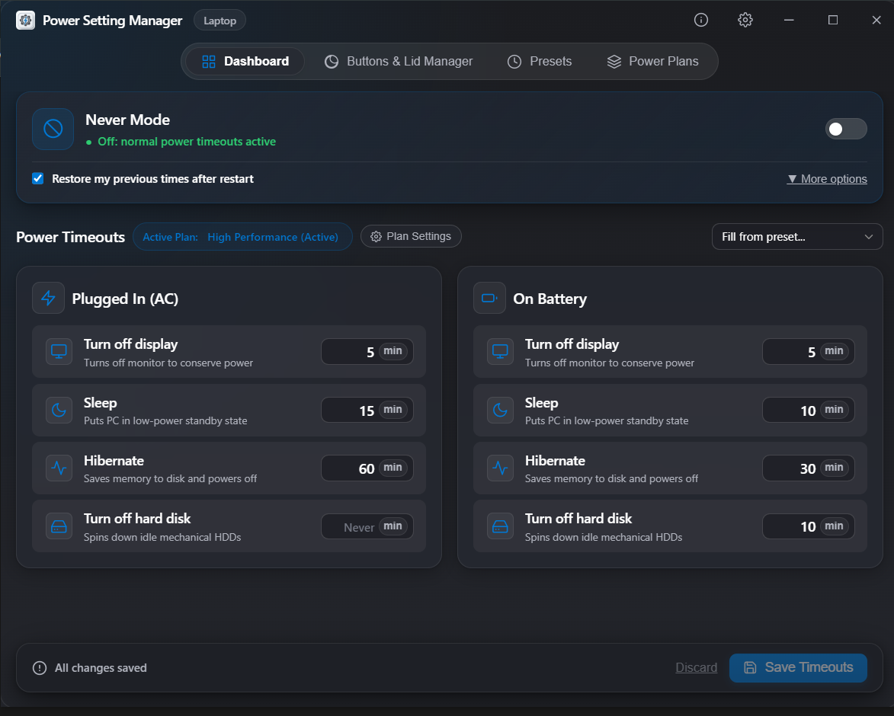
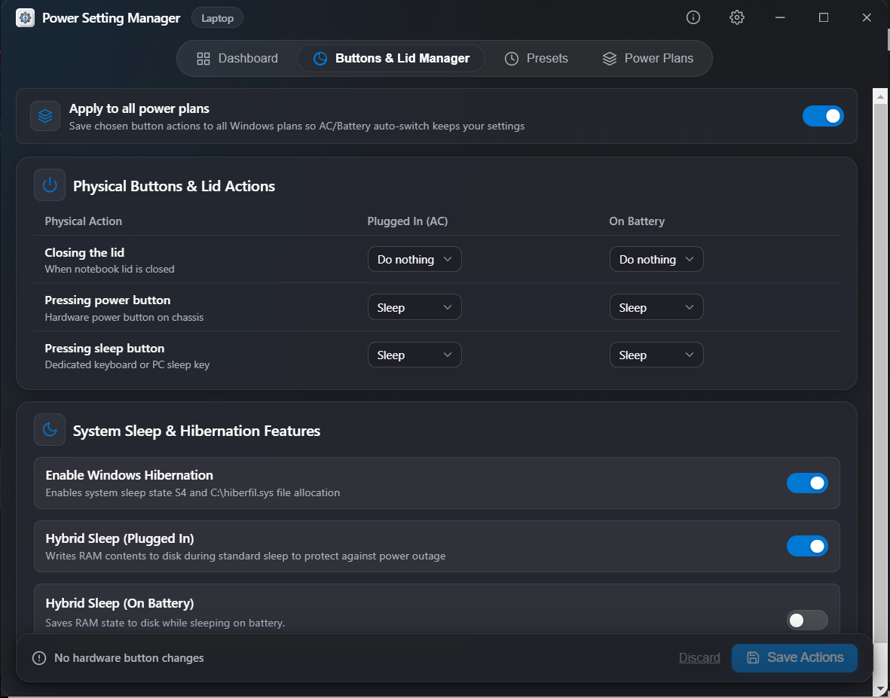
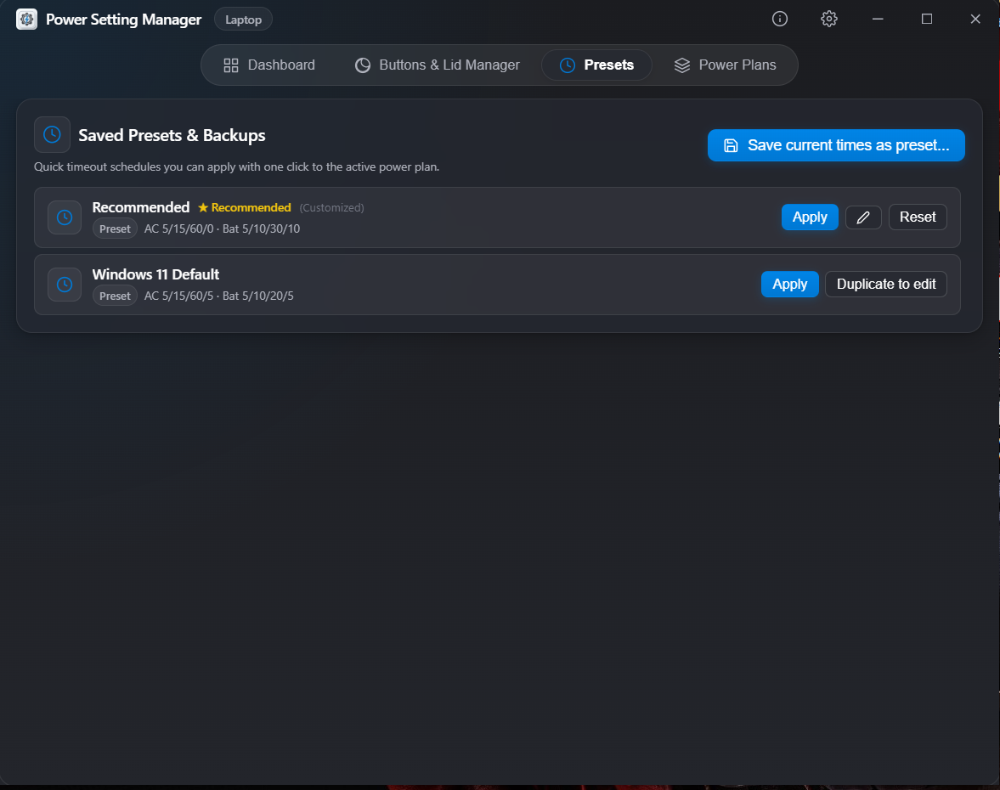
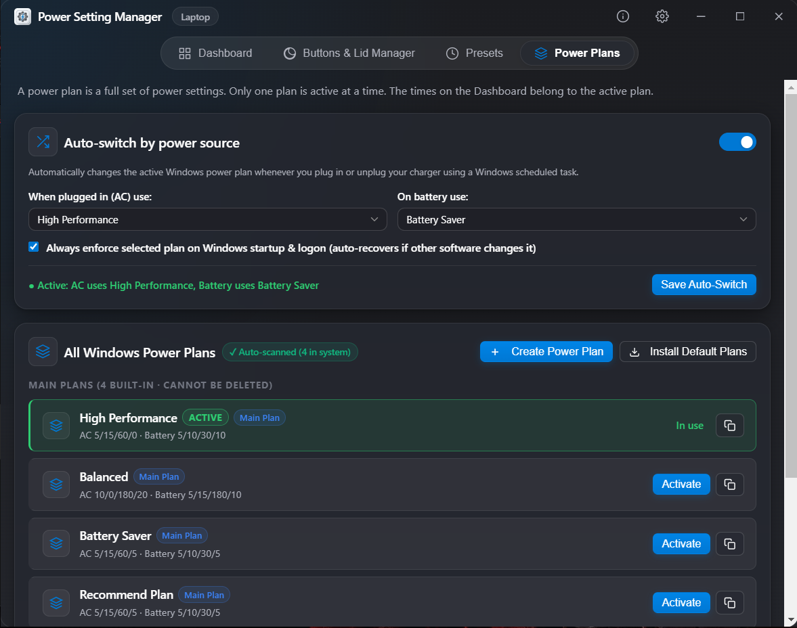

# ⚡ Power Setting Manager

A simple Windows app to control your PC's sleep, screen, lid, and power button settings in one place.

---

## ✨ Features

* **⏱️ Easy Timeouts**: Set when your screen turns off, and when your PC sleeps or hibernates, for both plugged in and battery.
* **🌙 Never Mode**: Keep your PC awake with one switch.
* **🔘 Lid & Button Actions**: Choose what happens when you close the lid or press the power or sleep button.
* **⚡ Auto-Switch Plans**: Change your power plan automatically when you plug in or unplug the charger.
* **💾 Presets**: Save your favorite settings and apply them in one click.
* **💤 Sleep Options**: Turn Hibernation and Hybrid Sleep on or off.

---

## 🆕 What's New in v3.1.1

* Fill timeouts quickly using **Fill from preset**.
* Never Mode can **restore your old times after restart**.
* New **Presets** page: save, edit, reset, and duplicate presets.
* **Apply to all power plans** option for lid and button actions.
* Separate Hybrid Sleep switches for AC and Battery.
* Create new power plans or install the default ones.
* Optional **auto-fix on startup** if other software changes your power plan.
* **Save** and **Discard** buttons so you never apply changes by accident.

---

## 📸 Screenshots

### Dashboard
Change your timeouts and turn Never Mode on or off.

### Buttons & Lid Manager
Choose what the lid and buttons do.

### Presets
Save and reuse your favorite settings.

### Power Plans
See all plans and set up auto-switching.

---

## 📥 Installation

1. Go to the [Releases Page](https://github.com/your-username/power-setting-manager/releases).
2. Download **`PowerSettingManager-3.1.1-Setup.exe`**.
3. Run the installer and follow the steps.

---

## 🚀 How to Use

1. **Change timeouts**: Open **Dashboard**, set your times, then click **Save Timeouts**.
2. **Auto-switch plans**: Open **Power Plans**, turn on **Auto-switch**, pick a plan for AC and Battery, then click **Save Auto-Switch**.
3. **Lid and buttons**: Open **Buttons & Lid Manager**, pick your actions, then click **Save Actions**.
4. **Presets**: Open **Presets** and click **Apply** on any preset.

---

## 🛠️ Built With

* Windows Power Management (`PowerCfg`)
* Windows 10 and 11 (x64)

---

## 📄 License

MIT License. See `LICENSE` for details.
